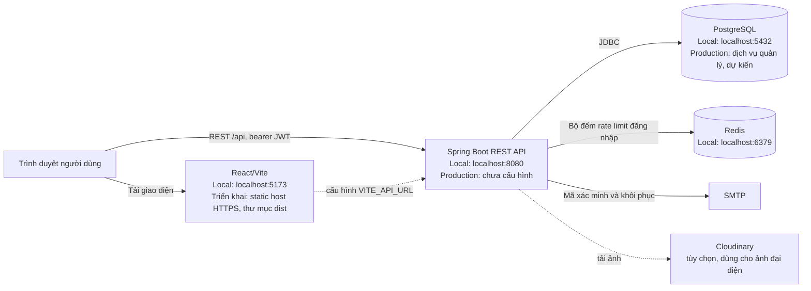

# Otech

Otech là ứng dụng cộng đồng và mua bán hàng hóa đã qua sử dụng. Repository gồm giao diện React/Vite và REST API xây dựng bằng Spring Boot.

## Tính năng

- Đăng ký tài khoản, xác minh email, đăng nhập và khôi phục mật khẩu.
- Đăng, sửa và ẩn bài viết ở homepage; đính kèm ảnh, like/unlike, bình luận, trả lời và chia sẻ bài viết.
- Xem bảng tin công khai; khách chỉ xem, còn thao tác đăng và tương tác yêu cầu đăng nhập.
- Cập nhật hồ sơ, đổi mật khẩu và tải ảnh đại diện.
- Mở hồ sơ công khai từ avatar bài đăng, xem bài viết và theo dõi hoặc nhắn tin cho thành viên.
- Tìm kiếm, lọc, xem chi tiết, đăng và quản lý tin sản phẩm đã qua sử dụng.
- Nhắn tin theo sản phẩm hoặc trực tiếp; lưu lịch sử, cập nhật realtime và trạng thái đã đọc.
- Khám phá nhóm theo danh mục hàng hóa; tạo, sửa, xóa nhóm; tham gia nhóm công khai hoặc gửi yêu cầu vào nhóm riêng tư.
- Đăng bài trong nhóm, đính kèm ảnh; quản trị viên nhóm có thể bật/tắt duyệt bài, duyệt/từ chối bài viết và yêu cầu tham gia.
- Dashboard vận hành cho Manager/Admin: tìm kiếm người dùng, kiểm duyệt sản phẩm/bài viết/nhóm cộng đồng và xử lý báo cáo.
- Admin tạo, khóa/mở khóa, vô hiệu hóa Manager và chuyển vai trò giữa User/Manager.
- Giao diện responsive, hỗ trợ chế độ sáng/tối và cài đặt PWA.

Các luồng bài viết, marketplace, chat, nhóm và dashboard quản trị dùng API thật; giao dịch/thanh toán không thuộc phạm vi hệ thống. Nhóm được lưu trong bảng `groups` và dùng API `/api/groups`. Thông báo cho người dùng thông thường chưa được kết nối đầy đủ; một số khu vực giao diện cũ còn là nội dung giữ chỗ.

## Cấu trúc dự án

```text
backend/otech/   Spring Boot API, Maven Wrapper và kiểm thử Java
frontend/        React/Vite, npm lockfile và cấu hình PWA
```

Backend tổ chức theo tính năng (`auth`, `post`, `profile`); entity, bảo mật, cấu hình và gửi email nằm trong package `com.vn.otech`.

## Kiến trúc triển khai

Sơ đồ dưới đây mô tả cách các thành phần kết nối khi phát triển local và khi triển khai theo mô hình dự kiến. Repository chưa có cấu hình hạ tầng production.



Frontend và backend là hai tiến trình riêng. Khi triển khai, cần cấu hình URL API ở thời điểm build frontend, CORS ở backend và secret ở môi trường chạy backend. SMTP và Cloudinary là dịch vụ ngoài; chỉ cần bật khi sử dụng các luồng tương ứng.

## Công nghệ

- Java 21 và Maven Wrapper
- Node.js và npm
- PostgreSQL
- Redis để lưu bộ đếm đăng nhập sai và trạng thái khóa dùng chung giữa các instance API
- SMTP để gửi mã xác minh và khôi phục mật khẩu
- Cloudinary để bật tải ảnh đại diện

Hibernate không tự tạo schema vì `spring.jpa.hibernate.ddl-auto=none`. Toàn bộ thay đổi database, gồm bảng `post_shares`, được quản lý trong file `script.sql` ở thư mục cha của repository. Chạy file này trong pgAdmin hoặc psql để cập nhật database hiện tại. Với database cũ, script đổi tên các bảng và enum `page` sang `group` mà không xóa dữ liệu; có thể chạy riêng `migrate_pages_to_groups.sql` trước khi triển khai code mới. Luồng nhóm hỗ trợ danh mục hàng hóa (`category_id`) và trạng thái/cấu hình duyệt bài.

## Cấu hình

Backend đọc các biến môi trường sau. Hãy cấu hình chúng trong môi trường chạy, không ghi thông tin bí mật vào mã nguồn.

| Biến | Mục đích | Mặc định / ghi chú |
| --- | --- | --- |
| `DB_URL` | JDBC URL của PostgreSQL | `jdbc:postgresql://localhost:5432/Otech` |
| `DB_USERNAME`, `DB_PASSWORD` | Tài khoản cơ sở dữ liệu | Bắt buộc; không có thông tin xác thực mặc định trong source |
| `REDIS_HOST`, `REDIS_PORT`, `REDIS_PASSWORD` | Kết nối Redis cho rate limit đăng nhập | `localhost`, `6379`, không mật khẩu |
| `JWT_SECRET` | Khóa ký JWT | Bắt buộc; dùng khóa riêng, ngẫu nhiên, tối thiểu 32 byte |
| `JWT_EXPIRATION_MS` | Thời hạn JWT, mili giây | `86400000` |
| `SERVER_PORT` | Cổng API | `8080` |
| `CORS_ALLOWED_ORIGINS` | Danh sách origin frontend, phân tách bằng dấu phẩy | `http://localhost:5173` |
| `MAIL_HOST`, `MAIL_PORT`, `MAIL_USERNAME`, `MAIL_PASSWORD` | Kết nối SMTP | Host mặc định `smtp.gmail.com`, cổng `587`; cung cấp thông tin đăng nhập qua môi trường khi bật gửi mail |
| `MAIL_FROM` | Địa chỉ gửi email | Mặc định lấy từ `MAIL_USERNAME` |
| `MAIL_SMTP_AUTH`, `MAIL_SMTP_STARTTLS` | Xác thực SMTP và TLS | Mặc định bật |
| `CLOUDINARY_CLOUD_NAME`, `CLOUDINARY_API_KEY`, `CLOUDINARY_API_SECRET` | Lưu ảnh đại diện, ảnh bài viết và tin sản phẩm | Tùy chọn; lấy đúng ba giá trị từ Cloudinary Dashboard, chỉ bật upload khi cung cấp đủ thông tin qua môi trường |
| `RESET_TOKEN_EXPIRATION_MINUTES` | Thời hạn mã khôi phục mật khẩu | `30` |
| `SIGNUP_OTP_EXPIRATION_MINUTES` | Thời hạn mã xác minh đăng ký | `10` |
| `LOGIN_MAX_FAILURES`, `LOGIN_LOCKOUT_MINUTES` | Số lần đăng nhập sai tối đa và thời hạn rate limit | `5` lần trong `15` phút |

Source không lưu mật khẩu cơ sở dữ liệu, thông tin đăng nhập SMTP/Cloudinary hoặc khóa JWT. Hãy cấu hình chúng qua biến môi trường; API key phải đi cùng API secret thuộc cùng một Cloudinary account. Nếu Cloudinary trả lỗi `Invalid Signature`, kiểm tra lại Cloud name, API Key và API Secret trong Cloudinary Dashboard, sau đó khởi động lại backend. Không dùng `.env` của frontend để cấu hình backend. Nếu credential từng được lưu trong lịch sử Git còn hiệu lực, hãy thu hồi và thay mới.

Để cấu hình upload local, sao chép `backend/otech/.env.example` thành `backend/otech/.env`, điền Cloud name, API key và API secret từ cùng một Cloudinary account rồi khởi động backend với working directory `backend/otech`. `.env` đã được Git bỏ qua. Có thể thay bằng ba biến môi trường tương ứng; backend phải được khởi động lại sau khi cập nhật cấu hình.

Frontend đọc tùy chọn `VITE_API_URL`, mặc định là `http://localhost:8080/api`. File mẫu nằm tại `frontend/.env.example`; có thể tạo `frontend/.env.local` để ghi URL riêng cho máy phát triển.

Các kiểm thử khởi động backend dùng profile `test` với H2 trong bộ nhớ và khóa ký dành riêng cho kiểm thử; chúng không cần credential của môi trường chạy ứng dụng.

## Bắt đầu

1. Cài Java 21, Node.js/npm, PostgreSQL và Redis; tạo cơ sở dữ liệu, khởi động Redis tại `localhost:6379` (hoặc cấu hình `REDIS_HOST`, `REDIS_PORT`, `REDIS_PASSWORD`), sau đó áp dụng `script.sql` được cung cấp cùng workspace:

   ```powershell
   Set-Location Otech
   psql -h localhost -U postgres -d Otech -f ..\script.sql
   ```

   Nếu database đã có dữ liệu, có thể chạy lại **toàn bộ** `script.sql` trên đúng database. Các bảng, kiểu enum, cột bổ sung và index dùng `IF NOT EXISTS`; seed mẫu có xử lý xung đột hoặc kiểm tra trước khi thêm để tránh nhân bản. Phần cập nhật chat tạo `messages.client_message_id` nếu chưa có; đây là thay đổi additive, không xóa hay sửa tin nhắn hiện có. Không dùng bản `script.sql` cũ vì bản đó chưa tạo cột này. Đảm bảo URL và tài khoản cơ sở dữ liệu khớp với backend.
2. Mở PowerShell tại thư mục gốc `Otech`, đặt `DB_USERNAME`, `DB_PASSWORD` và `JWT_SECRET` trong môi trường chạy backend. Dùng khóa JWT ngẫu nhiên riêng cho từng môi trường (tối thiểu 32 byte). Cấu hình `MAIL_USERNAME`/`MAIL_PASSWORD` để gửi mã xác minh/khôi phục; cấu hình đủ ba biến Cloudinary để tải ảnh. Không ghi các giá trị này vào file được commit.
3. Khởi động backend:

   ```powershell
   Set-Location backend/otech
   .\mvnw.cmd spring-boot:run
   ```

   API mặc định chạy tại `http://localhost:8080`.

4. Mở terminal khác, cài dependency và chạy frontend:

   ```powershell
   Set-Location frontend
   npm ci
   npm run dev
   ```

   Mở URL Vite in ra, thường là `http://localhost:5173`. Nếu API chạy ở địa chỉ khác, đặt `VITE_API_URL` trong `frontend/.env.local` thành URL gốc `/api`. Origin frontend phải có trong `CORS_ALLOWED_ORIGINS` của backend.

## API hiện có

Các endpoint dùng tiền tố `/api`.

| Phương thức | Endpoint | Quyền truy cập | Chức năng |
| --- | --- | --- | --- |
| `POST` | `/auth/signup` | Công khai | Đăng ký và gửi mã xác minh |
| `POST` | `/auth/verify-signup` | Công khai | Xác minh đăng ký và cấp JWT |
| `POST` | `/auth/resend-signup-otp` | Công khai | Gửi lại mã xác minh |
| `POST` | `/auth/login` hoặc `/auth/signin` | Công khai | Đăng nhập và cấp JWT |
| `POST` | `/auth/logout` | Công khai; nhận bearer token nếu có | Thu hồi token hiện tại khi token được gửi |
| `POST` | `/auth/forgot-password` | Công khai | Yêu cầu mã khôi phục mật khẩu |
| `POST` | `/auth/reset-password` | Công khai | Đặt lại mật khẩu bằng mã |
| `GET` | `/posts` | Công khai | Lấy feed; gồm số like/bình luận/chia sẻ và trạng thái like của người xem đã đăng nhập |
| `POST` | `/posts` | Đã xác thực | Tạo bài viết văn bản, kèm tối đa một ảnh HTTPS tùy chọn |
| `PUT`, `DELETE` | `/posts/{postId}` | Chủ bài viết | Sửa bài viết hoặc ẩn bài viết của mình |
| `PUT`, `DELETE` | `/posts/{postId}/likes` | Đã xác thực | Like/unlike idempotent |
| `GET`, `POST` | `/posts/{postId}/comments` | Đọc công khai; tạo yêu cầu đăng nhập | Bình luận hoặc trả lời bình luận bằng `parentCommentId` |
| `PUT` | `/posts/{postId}/shares` | Đã xác thực | Chia sẻ bài viết; mỗi người dùng được tính tối đa một lượt cho mỗi bài |
| `GET` | `/profiles/{userId}` | Công khai | Hồ sơ thành viên, bài đăng và số liệu follow |
| `POST`, `DELETE` | `/profiles/{userId}/follow` | Đã xác thực | Theo dõi hoặc bỏ theo dõi thành viên |
| `PATCH` | `/user/profile` | Đã xác thực | Cập nhật hồ sơ, có thể đổi mật khẩu |
| `POST` | `/user/profile/avatar` | Đã xác thực | Tải ảnh lên bằng multipart field `file` |
| `GET` | `/categories` | Công khai | Danh mục sản phẩm |
| `GET` | `/products` | Công khai | Tìm kiếm, lọc, sắp xếp và phân trang tin |
| `GET` | `/products/{productId}` | Công khai | Chi tiết tin đang bán hoặc đã bán |
| `GET` | `/user/products` | Đã xác thực | Danh sách tin của người dùng hiện tại |
| `POST` | `/products` | Đã xác thực | Đăng tin sản phẩm |
| `PUT` | `/products/{productId}` | Chủ tin hoặc Manager/Admin | Cập nhật nội dung và ảnh; thay thế toàn bộ request |
| `PATCH` | `/products/{productId}/status` | Chủ tin hoặc Manager/Admin | Chuyển trạng thái `SELLING`, `SOLD` hoặc `HIDDEN` |
| `DELETE` | `/products/{productId}` | Chủ tin hoặc Manager/Admin | Lưu trữ tin bằng trạng thái `HIDDEN`, giữ lịch sử chat |
| `POST` | `/products/images` | Đã xác thực | Tải JPEG/PNG/WebP tối đa 8 MB cho tin sản phẩm hoặc bài viết; cần cấu hình Cloudinary |
| `GET` | `/conversations` | Đã xác thực | Liệt kê hội thoại; chỉ hiển thị một luồng cho mỗi người trò chuyện |
| `POST` | `/conversations` | Đã xác thực | Tạo/lấy hội thoại theo cặp người dùng; nhắn từ Marketplace dùng lại hội thoại trực tiếp hiện có |
| `GET` | `/conversations/{id}/messages` | Thành viên hội thoại | Lịch sử tin nhắn, phân trang cursor và tự đánh dấu đã đọc |
| `POST` | `/conversations/{id}/messages` | Thành viên hội thoại | Gửi tin dự phòng qua HTTP; gửi lại cùng `clientMessageId` không tạo bản sao |
| `POST` | `/conversations/{id}/read` | Thành viên hội thoại | Đánh dấu tin đến là đã đọc |
| `GET` | `/manager/dashboard` | Manager/Admin | Thống kê User, sản phẩm, bài viết, Page, báo cáo và Manager |
| `GET` | `/manager/users`, `/manager/products`, `/manager/posts`, `/manager/groups`, `/manager/reports` | Manager/Admin | Danh sách quản trị có tìm kiếm/lọc; phân trang bằng `page`/`size` (tối đa 100) |
| `PATCH` | `/manager/users/{id}/status` | Manager/Admin | Khóa/mở khóa tài khoản USER; không sửa tài khoản Manager/Admin |
| `PATCH` | `/manager/products/{id}/visibility`, `/manager/posts/{id}/visibility`, `/manager/groups/{id}/visibility` | Manager/Admin | Ẩn/hiện nội dung; sản phẩm đã bán không thể khôi phục thành đang bán |
| `PATCH` | `/manager/reports/{id}` | Manager/Admin | Chấp nhận báo cáo để ẩn/khóa đối tượng hoặc từ chối; chỉ xử lý báo cáo đang chờ |
| `POST` | `/admin/managers` | Admin | Tạo tài khoản Manager đã xác minh email |
| `PATCH`, `DELETE` | `/admin/managers/{id}` và `/admin/managers/{id}/status` | Admin | Đổi trạng thái Manager hoặc vô hiệu hóa tài khoản (xóa mềm) |
| `PATCH` | `/admin/users/{id}/role` | Admin | Chuyển vai trò USER↔MANAGER; không cấp hoặc sửa vai trò Admin |
| `GET` | `/groups?search=&categoryId=&page=&size=` | Công khai | Khám phá nhóm theo tên và danh mục hàng hóa |
| `GET` | `/groups/mine`, `/groups/{id}` | Đã xác thực (mine); chi tiết công khai/nhóm riêng tư | Danh sách nhóm do người dùng tạo hoặc thông tin nhóm |
| `POST`, `PUT`, `DELETE` | `/groups`, `/groups/{id}` | Đã xác thực; sửa/xóa chỉ dành cho chủ nhóm (Admin có thể xóa) | Tạo/sửa/xóa nhóm; mỗi nhóm gắn với danh mục hàng hóa |
| `POST`, `DELETE` | `/groups/{id}/membership` | Đã xác thực | Tham gia/rời nhóm công khai hoặc gửi/hủy yêu cầu vào nhóm riêng tư |
| `GET`, `PUT` | `/groups/{id}/join-requests` và `/groups/{id}/join-requests/{requestId}` | Chủ nhóm/Moderator | Liệt kê, chấp nhận hoặc từ chối yêu cầu tham gia |
| `GET`, `POST` | `/groups/{id}/posts` | Đọc nhóm công khai; đăng bài cần là thành viên | Xem/đăng bài viết văn bản và ảnh; bài thành viên chờ duyệt theo cấu hình nhóm |
| `GET`, `PUT` | `/groups/{id}/posts/pending`, `/groups/{id}/posts/{postId}/moderation?status=APPROVED\|REJECTED` | Chủ nhóm/Moderator | Duyệt hoặc từ chối bài đang chờ |
| `PUT`, `DELETE` | `/groups/{id}/posts/{postId}` | Tác giả; Moderator có thể quản lý bài | Sửa hoặc xóa bài viết nhóm |

Dashboard dùng chung tại `/manager` cho Manager và `/admin` cho Admin. Manager chỉ vận hành User/nội dung/báo cáo; Admin có thêm tab quản lý Manager và thay đổi vai trò. Các thao tác quản trị được kiểm tra tại backend; khóa tài khoản cũng vô hiệu hóa JWT đang còn hạn.

`GET /products` nhận `search`, `categoryId`, `minPrice`, `maxPrice`, `condition`, `location`, `status`, `sort`, `cursor` và `limit` (tối đa 48). `sort` cho phép `newest`, `oldest`, `price-asc`, `price-desc`; mặc định chỉ trả `SELLING`, còn tin `HIDDEN` không xuất hiện công khai. Kết quả có dạng `{ "items": [...], "hasMore": true, "nextCursor": "..." }`; dùng cursor trả về cho trang tiếp theo.

## Chat WebSocket

Backend mở STOMP endpoint tại `/ws` (WebSocket thuần, không dùng token trong URL). Gửi JWT ở STOMP `CONNECT` native header `Authorization: Bearer <JWT>`, sau đó:

- Subscribe `/user/queue/messages`, `/user/queue/message-status` và `/user/queue/errors`.
- Gửi tin đến `/app/conversations/{conversationId}/messages` với `{ "clientMessageId": "<UUID>", "content": "..." }`.
- Đánh dấu đã đọc bằng `/app/conversations/{conversationId}/read`.

Mọi thao tác đều xác minh thành viên hội thoại ở backend; chỉ origin trong `CORS_ALLOWED_ORIGINS` được bắt tay WebSocket. Lỗi API dùng envelope `{ "error": { "code", "message", "details" } }`. Simple broker phù hợp cho local/một backend instance; nếu chạy nhiều instance cần thay bằng broker relay dùng chung.

Request cần xác thực gửi header `Authorization: Bearer <token>`. Frontend lưu token trong `localStorage` và gửi qua API helper dùng chung.

## Kiểm thử

Chạy frontend trong thư mục `frontend/`:

```powershell
npm run lint
npm run build
```

Chạy backend trong thư mục `backend/otech/`:

```powershell
.\mvnw.cmd test
```

Backend có unit test cho auth, email, post, profile, JWT, marketplace, chat và một kiểm thử khởi động ứng dụng. Kiểm thử frontend, API độc lập, E2E và báo cáo coverage chưa được cấu hình. Lệnh lint toàn dự án vẫn có một số lỗi có sẵn trong source cũ; các file frontend thay đổi được lint riêng khi kiểm tra.

## Triển khai

Repository hiện chưa có CI/CD, Docker hay cấu hình staging/production. Các bước dưới đây hướng dẫn đóng gói thủ công; dự án chưa có môi trường production được cấu hình trong repository.

1. Chuẩn bị PostgreSQL bên ngoài và áp dụng schema tương thích với mã nguồn. Schema hiện phải được cung cấp riêng, vì vậy quy trình chưa thể tái lập chỉ từ repository.
2. Cấu hình secret trong secret manager của nền tảng: thông tin database, `JWT_SECRET`, SMTP và Cloudinary. Không dùng các giá trị dự phòng đang có trong mã nguồn. Đặt `SERVER_PORT` và `CORS_ALLOWED_ORIGINS` theo môi trường đích.
3. Đóng gói và chạy backend:

   ```powershell
   Set-Location backend/otech
   .\mvnw.cmd clean package
   ```

   Artifact dự kiến: `target/otech-0.0.1-SNAPSHOT.jar`. Chạy bằng `java -jar target/otech-0.0.1-SNAPSHOT.jar` sau khi đã cấu hình biến môi trường. Cần bổ sung health check và log/giám sát trước khi mở dịch vụ production.

4. Build frontend:

   ```powershell
   Set-Location frontend
   npm ci
   npm run build
   ```

   Phân phối thư mục `dist/` qua static hosting có HTTPS và fallback về `index.html` cho SPA. Đặt `VITE_API_URL` trước khi build để nhúng URL API môi trường đích; cấu hình CORS backend cho đúng origin frontend.
5. Trước khi mở truy cập, kiểm tra đăng nhập, xác minh email, hồ sơ, kết nối database và upload ảnh. Lưu artifact/version đã phát hành và ghi lại quy trình rollback; hiện chưa có rollback tự động, health-check endpoint, giám sát/cảnh báo hoặc bằng chứng triển khai staging/production.

## Nợ kỹ thuật và kế hoạch xử lý

Danh sách dưới đây sắp xếp các việc cần xử lý theo mức độ ưu tiên. P0 cần hoàn thành trước khi triển khai dùng thật; P1 trước khi mở staging; P2 nhằm cải thiện khả năng bảo trì và vận hành.

| Ưu tiên | Nợ kỹ thuật | Kế hoạch xử lý | Điều kiện hoàn tất |
| --- | --- | --- | --- |
| P0 | **Credential từng được commit:** cấu hình hiện không còn giá trị bí mật mặc định, nhưng credential từng xuất hiện trong lịch sử Git có thể vẫn còn hiệu lực. | Thu hồi/đổi các credential SMTP/Cloudinary và khóa JWT từng commit; giữ secret ngoài Git và cấp qua biến môi trường/secret manager riêng cho từng môi trường. | Credential cũ đã được thu hồi; source và cấu hình triển khai không chứa secret; mỗi môi trường dùng khóa riêng. |
| P0 | **Schema không nằm trong repository:** `script.sql` ở ngoài repo; Hibernate không tự tạo schema. | Đưa schema vào repository hoặc bổ sung công cụ migration có version; thêm hướng dẫn tạo database sạch. | Một contributor clone mới có thể tạo schema và chạy test/integration setup mà không cần file ngoài workspace. |
| P1 | **Lint frontend chưa đạt:** source cũ còn lỗi Fast Refresh và hook; thư mục `dev-dist` là output PWA sinh tự động. | Loại trừ artifact sinh tự động khỏi phạm vi lint; sửa các lỗi lint còn lại trong source; giữ lệnh lint trong CI. | `npm run lint` chạy thành công trên source; CI chặn merge khi lint thất bại. |
| P1 | **Thiếu kiểm thử giao diện và tích hợp:** backend có unit test nhưng chưa có kiểm thử frontend, API/E2E hoặc báo cáo coverage. | Bổ sung kiểm thử API cho auth/profile/posts; thêm E2E cho luồng người dùng chính; cấu hình thu thập coverage và kiểm thử trường hợp lỗi/biên. | Các luồng chính được kiểm tra tự động; pipeline tạo báo cáo coverage và đạt ngưỡng do nhóm thống nhất. |
| P1 | **Các miền ngoài marketplace/chat chưa hoàn chỉnh:** tương tác bài đăng, Page, thông báo, báo cáo và quản trị vẫn thiếu API/UI đầy đủ; có khu vực cũ chỉ đổi state cục bộ hoặc giữ chỗ. | Với từng user story còn lại, bổ sung acceptance criteria, API/UI, kiểm thử và cập nhật tài liệu; ẩn hoặc vô hiệu hóa phần chưa hỗ trợ. | 100% tính năng đã cam kết có acceptance criteria, luồng backend/frontend, kiểm thử và tài liệu tương ứng. |
| P1 | **Chưa có quy trình CI/CD và phát hành:** không tìm thấy workflow CI, Docker, security scan, staging, rollback hay monitoring. | Tạo pipeline build, lint, static/security analysis, test và đóng gói; cấu hình secret management; bổ sung quy trình phát hành, rollback, health check, log và cảnh báo. | Pipeline xanh ổn định; có hướng dẫn staging/production đã chạy thử, version phát hành và rollback được kiểm chứng. |
| P1 | **Giới hạn mở rộng của rate limit đăng nhập:** bộ đếm thất bại trước đây nằm trong `ConcurrentHashMap` của `AuthService`, chỉ tồn tại trong một tiến trình và mất khi restart. | Dùng Redis làm bộ đếm dùng chung có thời hạn cho rate limit đăng nhập. | Ngưỡng rate limit được áp dụng nhất quán qua các instance và bộ đếm tự hết hạn. |
| P2 | **Thiếu tài liệu kiến trúc và dữ liệu:** chưa có đầy đủ sơ đồ nghiệp vụ, ngữ cảnh, thành phần, ERD và trình tự; chưa có từ điển dữ liệu, yêu cầu phi chức năng đo được và quyết định kiến trúc. | Bổ sung tài liệu cho các luồng và mô hình dữ liệu đang hoạt động; ghi lại lý do cho quyết định ảnh hưởng cấu trúc hệ thống. | Người tiếp nhận có thể lần theo luồng chính, hiểu schema và tra cứu lý do của quyết định kiến trúc. |

P0/P1/P2 là thứ tự ưu tiên đề xuất. Nhóm phát triển cần phân công người phụ trách và mốc thời gian cho từng hạng mục trong công cụ quản lý công việc.
